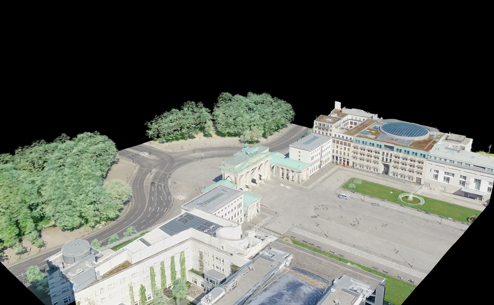
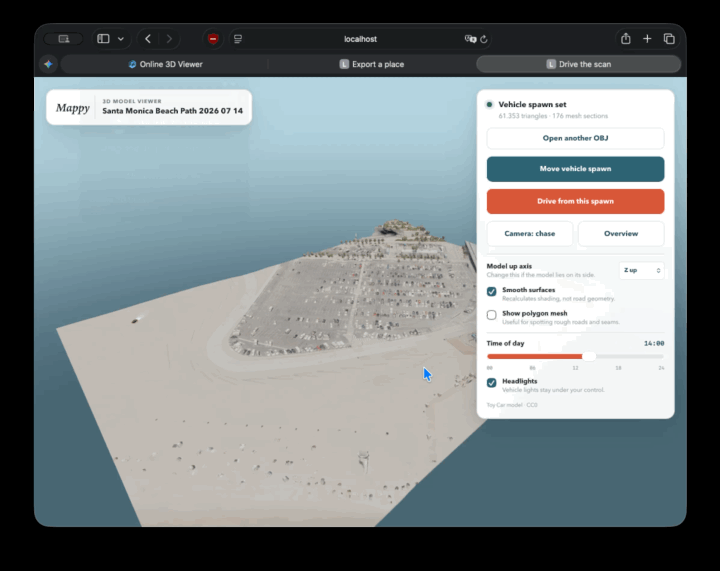

# Orbis

**Export real places as textured 3D models for any engine or app.**

Orbis pulls Apple's 3D city data for an area, including the newer iOS 27 data
with its soft splat trees, and writes it as a single `GLB` (Unity, Unreal,
Godot, Blender, three.js, Babylon), a `USDZ` (Xcode, RealityKit, Reality
Composer, Quick Look, visionOS), standard Gaussian splats (`PLY`), an `OBJ`
package, or a Minecraft world. It runs locally as a command-line tool, a Go library, and a
browser UI. No account, no upload.

```bash
orbis export --place "Brandenburger Tor" --size 200
```



▶ [Watch the 40-second launch film](docs/launch/orbis-launch.mp4) (made with [Remotion](https://www.remotion.dev), source in [`promo/`](promo/)).

> [!IMPORTANT]
> Orbis is an experimental research project. It uses Apple's undocumented map
> service. Coverage is incomplete, and the exported data is Apple's and subject
> to Apple's terms: see [Licensing and data terms](#licensing-and-data-terms).

## Contents

- [Quick start](#quick-start)
- [Output formats](#output-formats)
- [Command line](#command-line)
- [Go library](#go-library)
- [Browser UI](#browser-ui)
- [Coverage: classic vs. Apple's new 3D format](#coverage-classic-vs-apples-new-3d-format)
- [Configuration](#configuration)
- [Build from source](#build-from-source)
- [Credits](#credits) · [Licensing and data terms](#licensing-and-data-terms)

## Quick start

```bash
go install github.com/Henkek221/orbis/cmd/orbis@latest   # or grab a release ZIP

orbis search "Arc de Triomphe"                          # find coordinates
orbis coverage --place "Arc de Triomphe"                 # is there 3D data?
orbis export --place "Arc de Triomphe" --size 200        # → arc-de-triomphe/arc-de-triomphe.glb
orbis export --center 47.6205,-122.3493 --size 250 --format glb,usdz,obj
```

On macOS Orbis configures itself. On Windows and Linux, import a `config.json`
once (see [Configuration](#configuration)).

## Output formats

| Format | Flag | Use it for | Notes |
| --- | --- | --- | --- |
| **GLB** (glTF 2.0) | `glb` *(default)* | Unity, Unreal, Godot, Blender, three.js, Babylon, PlayCanvas | One file, embedded JPEG textures, metres, +Y up, unlit photo materials (`KHR_materials_unlit`) |
| **Gaussian splats** | `splats` *(default)* | SuperSplat, three.js, Babylon, PlayCanvas, Unity/Unreal splat plugins | Apple's soft triangles (newer regions) as 3DGS PLY, same frame as the GLB |
| **USDZ** / USDA | `usdz` | Xcode, RealityKit, Reality Composer, Quick Look, visionOS | `UsdPreviewSurface`; the `.usdz` is packaged with Apple's `usdzip` (macOS), elsewhere you get `.usda` + `textures/`. Quick Look cannot blend splats, so USD keeps only the vegetation splats |
| **OBJ** | `obj` | Any DCC tool | OBJ + MTL + one JPEG per tile; Z up (east-north-up) |
| **Minecraft** | `minecraft` | Java Edition 1.20.1+ worlds | Voxelized from the real mesh and photo colours, see [Minecraft](#minecraft-worlds) |

Every model uses a local frame in metres whose origin is the centre of the
export at ground level, so it imports at real scale and in place. For GLB and
USD: **+X east, +Y up, +Z south**. The GLB carries the geographic anchor in
`asset.extras.orbis` (`centre` lat/lon, `ecefOrigin`, bounds, triangle count),
so you can georeference several exports against each other.

Measured quality of the classic data at zoom 20: about 2–3 triangles and
800–950 texels per square metre (≈3.5 cm per texel), textures up to 512 px per
tile. Zoom 21+ returns nothing; zoom 20 is the ceiling.

## Command line

```
orbis export     export an area as GLB, USDZ, OBJ or a Minecraft world
orbis coverage   show which tiles of an area have 3D data
orbis search     find a place and print its coordinates
orbis regions    list the 3D regions the service announces
orbis config     show, import or scan the runtime configuration
orbis ui         open the browser interface
orbis version
```

An area is one of `--bbox W,S,E,N`, `--center LAT,LON` or `--place "Name"`,
the last two sized with `--size 250` or `--size 300x200` (metres).

`orbis export` flags:

| Flag | Default | |
| --- | --- | --- |
| `--format` | `glb,splats` | comma-separated: `glb`, `splats`, `usdz`, `obj`, `minecraft` |
| `--out` | `.` | directory that receives the export folder |
| `--name` | place or coordinates | export and folder name |
| `--zoom` | `20` | 13–20; 20 is source quality, 18 makes much smaller files |
| `--heights` | `24` | octree height layers; raise to 32+ for skyscrapers |
| `--parallel` | `16` | concurrent downloads |
| `--block-size` | `1` | Minecraft metres per block (0.25–4) |
| `--max-requests` | `200000` | safety limit, also `ORBIS_MAX_REQUESTS` |
| `--json` | | print the result as JSON on stdout (for scripts) |
| `--quiet` | | no progress |

Progress goes to stderr, results to stdout. `Ctrl-C` stops the scan and still
writes what was fetched. Exit codes: `0` ok, `1` error, `2` usage, `3` nothing
found.

```bash
# Script a batch, machine-readable:
orbis export --place "Duomo di Milano" --size 150 --json | jq -r .glb
```

## Go library

Everything the CLI does is in [`pkg/orbis`](pkg/orbis):

```go
client, err := orbis.Open(orbis.Options{ConfigPath: "config.json", CacheDir: "cache"})
if err != nil { log.Fatal(err) }

result, err := client.Export(ctx, orbis.Request{
	Name:   "space-needle",
	Bounds: orbis.BoundsAround(47.6205, -122.3493, 250, 250),
	GLB:    true,
	USD:    true,
	OutputRoot: "exports",
}, orbis.Progress{Log: func(s string) { log.Println(s) }})
```

Also available: `client.Coverage`, `client.Region`, `client.Regions`,
`orbis.Search`, `orbis.Reverse`, config helpers. To add your own output, pass a
`orbis.TileWriter` in `Request.Writers`: it receives every decoded tile (mesh,
materials, ECEF transform) in order.

## Browser UI

```bash
orbis ui
```

Search a place, switch on the coverage overlay, draw a rectangle, export, and
explore the result in the built-in viewer (orbit, walk, or drive). Existing OBJ
models open by drag and drop.




The release ZIPs start the UI by double-click (`Orbis.app`, `ORBIS STARTEN.cmd`,
`ORBIS STARTEN.sh`) and include a German quick-start file.

## Coverage: classic and Apple's new 3D format

As of November 2026 Apple serves 3D cities in two generations, and Orbis
reads both. It picks the right one per region automatically.

| | Classic (C3M) | New (R3D v2, style 98) |
| --- | --- | --- |
| Regions | 56 named regions, e.g. Paris, Milan, Madrid, Bordeaux, Seattle, Vancouver, US national parks | ~1,380 regions, e.g. Berlin, Hamburg, New York, London, Tokyo |
| Geometry | textured mesh | textured mesh **plus Apple's soft triangle splats** (trees, vegetation) |
| Index | C3MM octree (style 14) | occupancy index (style 100) |

Example: a 200 × 200 m export around the Brandenburger Tor yields 90 mesh
tiles and about 250,000 splats in 45 seconds. In regions that exist in both
formats the textures are byte-identical: the new format adds coverage and
splats, not resolution. The decoder lives in [`pkg/fly/r3d`](pkg/fly/r3d) and
matches the classic data within one quantisation step where both exist.

## Configuration

Orbis needs a static client value Apple compiles into its `GeoServices`
library. It is not a personal key, but treat it as private.

- **macOS:** nothing to do; Orbis reads it from the system.
- **Windows / Linux:** create a `config.json` once on any Mac and import it:

  ```bash
  orbis config write config.json        # on the Mac
  orbis config import config.json       # on Windows/Linux
  ```

  Or use [kvasir](https://github.com/Henkek221/kvasir), which drains an
  installed iOS simulator runtime: `orbis config import ~/mead` finds kvasir's
  `config.json` or the extracted `GeoServices` binary by itself.
  `orbis config scan <GeoServices>` reads the value from the binary directly.
- `orbis config` shows where the configuration comes from and tests it.

Data lives in `--home`, `$ORBIS_HOME`, the current directory when it holds a
`config.json`, or the user config directory (`~/Library/Application
Support/Orbis`, `%AppData%\Orbis`, `~/.config/Orbis`).
`FLYOVER_TOKEN_P1` and `FLYOVER_RESOURCE_MANIFEST_URL` override the file.

Never commit, upload, or include `config.json` in an issue.

## Minecraft worlds

Every block comes from a triangle of the scanned mesh and its photo colour:
supersampled triangles, colour averaging, Oklab palette matching, ordered
dithering, despeckling, flood-fill solidifying (buildings are solid, not
shells), and grass on open green surfaces. Copy the `…-minecraft` folder into
your saves. A world holds 384 blocks of height: at `--block-size 0.5` anything
above ~190 m is cut off.

## Build from source

Go 1.24+. Dependencies are vendored.

```bash
go build -mod=vendor -o orbis ./cmd/orbis
./scripts/build_orbis_releases.sh dev      # release ZIPs in dist/orbis/releases/
```

Newer Apple textures are HEIC. Go cannot decode HEIC without cgo, so Orbis
converts with `sips` (macOS), ImageMagick, `heif-convert` or `ffmpeg`, whichever
is installed. Without one, GLB/USD materials fall back to grey and OBJ keeps
`.heic` files.

## Credits

Orbis builds on substantial prior work:

- [retroplasma/flyover-reverse-engineering](https://github.com/retroplasma/flyover-reverse-engineering)
  for the original Flyover format, tile, and decoder research
- [christiangda/flyover-reverse-engineering](https://github.com/christiangda/flyover-reverse-engineering)
  for updates to newer Go and Protobuf versions
- [Leaflet](https://leafletjs.com/) and
  [OpenStreetMap contributors](https://www.openstreetmap.org/copyright) for the
  map and place search (Nominatim)
- Khronos Group's CC0 [Toy Car](internal/server/static/assets/TOY-CAR-LICENSE.txt)
  used in the viewer

See [CREDITS.md](CREDITS.md) for details.

## Licensing and data terms

Orbis is not developed, endorsed, or supported by Apple. Apple, Apple Maps, and
Flyover are trademarks or services of Apple Inc.

- **The data is Apple's.** Apple's Maps terms prohibit copying, extracting,
  scraping or bulk downloading the service's content. Use Orbis for research,
  prototyping and interoperability on your own machine. Do not redistribute
  exported geometry or imagery, do not ship it in a product, and do not use it
  to train models.
- **The code is not OSI open source yet.** The upstream repositories Orbis
  builds on publish no license. Code written for Orbis (`pkg/orbis`,
  `pkg/fly/exp/glb.go`, `pkg/fly/exp/usd.go`, `pkg/fly/r3d`, `pkg/mc`,
  `internal/server`, `cmd/orbis`) is the Orbis authors' own, but the repository
  as a whole must not be presented as open source or redistributed commercially
  until the inherited code's license is resolved.
