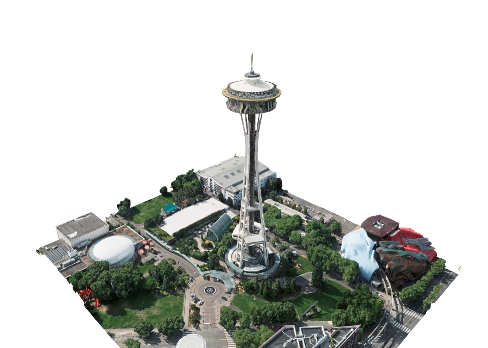
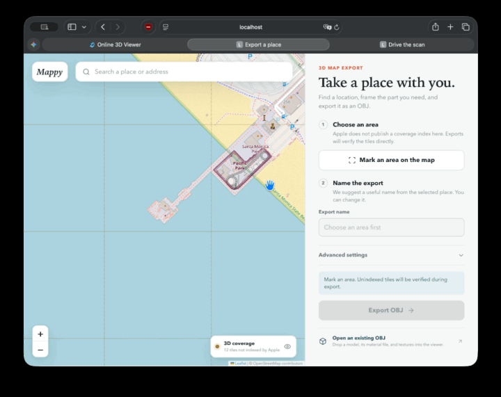

# Mappy

**Export real places as textured 3D models for any engine or app.**

Mappy pulls Apple's photogrammetry mesh for an area and writes it as a single
`GLB` (Unity, Unreal, Godot, Blender, three.js, Babylon), a `USDZ` (Xcode,
RealityKit, Reality Composer, Quick Look, visionOS), an `OBJ` package, or a
Minecraft world. It runs locally as a command-line tool, a Go library, and a
browser UI. No account, no upload.

```bash
mappy export --place "Space Needle, Seattle" --size 250
```



> [!IMPORTANT]
> Mappy is an experimental research project. It uses Apple's undocumented map
> service. Coverage is incomplete, and the exported data is Apple's and subject
> to Apple's terms: see [Licensing and data terms](#licensing-and-data-terms).

## Contents

- [Quick start](#quick-start)
- [Output formats](#output-formats)
- [Command line](#command-line)
- [Go library](#go-library)
- [Browser UI](#browser-ui)
- [Coverage: classic vs. Apple's new 3D format](#coverage-classic-vs-apples-new-3d-format)
- [Configuration](#configuration)
- [Build from source](#build-from-source)
- [Credits](#credits) · [Licensing and data terms](#licensing-and-data-terms)

## Quick start

```bash
go install github.com/Henkek221/mappy/cmd/mappy@latest   # or grab a release ZIP

mappy search "Arc de Triomphe"                          # find coordinates
mappy coverage --place "Arc de Triomphe"                 # is there 3D data?
mappy export --place "Arc de Triomphe" --size 200        # → arc-de-triomphe/arc-de-triomphe.glb
mappy export --center 47.6205,-122.3493 --size 250 --format glb,usdz,obj
```

On macOS Mappy configures itself. On Windows and Linux, import a `config.json`
once (see [Configuration](#configuration)).

## Output formats

| Format | Flag | Use it for | Notes |
| --- | --- | --- | --- |
| **GLB** (glTF 2.0) | `glb` *(default)* | Unity, Unreal, Godot, Blender, three.js, Babylon, PlayCanvas | One file, embedded JPEG textures, metres, +Y up, unlit photo materials (`KHR_materials_unlit`) |
| **USDZ** / USDA | `usdz` | Xcode, RealityKit, Reality Composer, Quick Look, visionOS | `UsdPreviewSurface`; the `.usdz` is packaged with Apple's `usdzip` (macOS), elsewhere you get `.usda` + `textures/` |
| **OBJ** | `obj` | Any DCC tool | OBJ + MTL + one JPEG per tile; Z up (east-north-up) |
| **Minecraft** | `minecraft` | Java Edition 1.20.1+ worlds | Voxelized from the real mesh and photo colours, see [Minecraft](#minecraft-worlds) |

Every model uses a local frame in metres whose origin is the centre of the
export at ground level, so it imports at real scale and in place. For GLB and
USD: **+X east, +Y up, +Z south**. The GLB carries the geographic anchor in
`asset.extras.mappy` (`centre` lat/lon, `ecefOrigin`, bounds, triangle count),
so you can georeference several exports against each other.

Measured quality of the classic data at zoom 20: about 2–3 triangles and
800–950 texels per square metre (≈3.5 cm per texel), textures up to 512 px per
tile. Zoom 21+ returns nothing; zoom 20 is the ceiling.

## Command line

```
mappy export     export an area as GLB, USDZ, OBJ or a Minecraft world
mappy coverage   show which tiles of an area have 3D data
mappy search     find a place and print its coordinates
mappy regions    list the 3D regions the service announces
mappy config     show, import or scan the runtime configuration
mappy ui         open the browser interface
mappy version
```

An area is one of `--bbox W,S,E,N`, `--center LAT,LON` or `--place "Name"`,
the last two sized with `--size 250` or `--size 300x200` (metres).

`mappy export` flags:

| Flag | Default | |
| --- | --- | --- |
| `--format` | `glb` | comma-separated: `glb`, `usdz`, `obj`, `minecraft` |
| `--out` | `.` | directory that receives the export folder |
| `--name` | place or coordinates | export and folder name |
| `--zoom` | `20` | 13–20; 20 is source quality, 18 makes much smaller files |
| `--heights` | `24` | octree height layers; raise to 32+ for skyscrapers |
| `--parallel` | `16` | concurrent downloads |
| `--block-size` | `1` | Minecraft metres per block (0.25–4) |
| `--max-requests` | `200000` | safety limit, also `MAPPY_MAX_REQUESTS` |
| `--json` | | print the result as JSON on stdout (for scripts) |
| `--quiet` | | no progress |

Progress goes to stderr, results to stdout. `Ctrl-C` stops the scan and still
writes what was fetched. Exit codes: `0` ok, `1` error, `2` usage, `3` nothing
found.

```bash
# Script a batch, machine-readable:
mappy export --place "Duomo di Milano" --size 150 --json | jq -r .glb
```

## Go library

Everything the CLI does is in [`pkg/mappy`](pkg/mappy):

```go
client, err := mappy.Open(mappy.Options{ConfigPath: "config.json", CacheDir: "cache"})
if err != nil { log.Fatal(err) }

result, err := client.Export(ctx, mappy.Request{
	Name:   "space-needle",
	Bounds: mappy.BoundsAround(47.6205, -122.3493, 250, 250),
	GLB:    true,
	USD:    true,
	OutputRoot: "exports",
}, mappy.Progress{Log: func(s string) { log.Println(s) }})
```

Also available: `client.Coverage`, `client.Region`, `client.Regions`,
`mappy.Search`, `mappy.Reverse`, config helpers. To add your own output, pass a
`mappy.TileWriter` in `Request.Writers`: it receives every decoded tile (mesh,
materials, ECEF transform) in order.

## Browser UI

```bash
mappy ui
```

Search a place, switch on the coverage overlay, draw a rectangle, export, and
explore the result in the built-in viewer (orbit, walk, or drive). Existing OBJ
models open by drag and drop.




The release ZIPs start the UI by double-click (`Mappy.app`, `MAPPY STARTEN.cmd`,
`MAPPY STARTEN.sh`) and include a German quick-start file.

## Coverage: classic vs. Apple's new 3D format

As of November 2026 Apple serves 3D cities in two generations:

| | Classic (C3M) | New (R3D v2, style 98) |
| --- | --- | --- |
| Regions | 56 named regions, e.g. Paris, Milan, Madrid, Bordeaux, Seattle, Vancouver, Cincinnati, US national parks | ~1,380 `Reg_z9_*` regions, e.g. Berlin, Hamburg, New York, London |
| Mappy | **fully supported** | **not yet**: container, index and textures are decoded ([`pkg/fly/r3d`](pkg/fly/r3d)); the compressed geometry codec is work in progress |
| Extras | — | Apple's own triangle splats (soft, RGBA, view-dependent), height raster (style 99) |

`mappy coverage` shows `?` for tiles of new-format regions. Within classic
regions, the R3D tiles carry byte-identical textures, so the new format adds
coverage and splats rather than resolution.

## Configuration

Mappy needs a static client value Apple compiles into its `GeoServices`
library. It is not a personal key, but treat it as private.

- **macOS:** nothing to do; Mappy reads it from the system.
- **Windows / Linux:** create a `config.json` once on any Mac and import it:

  ```bash
  mappy config write config.json        # on the Mac
  mappy config import config.json       # on Windows/Linux
  ```

  Or use [kvasir](https://github.com/Henkek221/kvasir), which drains an
  installed iOS simulator runtime: `mappy config import ~/mead` finds kvasir's
  `config.json` or the extracted `GeoServices` binary by itself.
  `mappy config scan <GeoServices>` reads the value from the binary directly.
- `mappy config` shows where the configuration comes from and tests it.

Data lives in `--home`, `$MAPPY_HOME`, the current directory when it holds a
`config.json`, or the user config directory (`~/Library/Application
Support/Mappy`, `%AppData%\Mappy`, `~/.config/Mappy`).
`FLYOVER_TOKEN_P1` and `FLYOVER_RESOURCE_MANIFEST_URL` override the file.

Never commit, upload, or include `config.json` in an issue.

## Minecraft worlds

Every block comes from a triangle of the scanned mesh and its photo colour:
supersampled triangles, colour averaging, Oklab palette matching, ordered
dithering, despeckling, flood-fill solidifying (buildings are solid, not
shells), and grass on open green surfaces. Copy the `…-minecraft` folder into
your saves. A world holds 384 blocks of height: at `--block-size 0.5` anything
above ~190 m is cut off.

## Build from source

Go 1.24+. Dependencies are vendored.

```bash
go build -mod=vendor -o mappy ./cmd/mappy
./scripts/build_mappy_releases.sh dev      # release ZIPs in dist/mappy/releases/
```

Newer Apple textures are HEIC. Go cannot decode HEIC without cgo, so Mappy
converts with `sips` (macOS), ImageMagick, `heif-convert` or `ffmpeg`, whichever
is installed. Without one, GLB/USD materials fall back to grey and OBJ keeps
`.heic` files.

## Credits

Mappy builds on substantial prior work:

- [retroplasma/flyover-reverse-engineering](https://github.com/retroplasma/flyover-reverse-engineering)
  for the original Flyover format, tile, and decoder research
- [christiangda/flyover-reverse-engineering](https://github.com/christiangda/flyover-reverse-engineering)
  for updates to newer Go and Protobuf versions
- [Leaflet](https://leafletjs.com/) and
  [OpenStreetMap contributors](https://www.openstreetmap.org/copyright) for the
  map and place search (Nominatim)
- Khronos Group's CC0 [Toy Car](internal/server/static/assets/TOY-CAR-LICENSE.txt)
  used in the viewer

See [CREDITS.md](CREDITS.md) for details.

## Licensing and data terms

Mappy is not developed, endorsed, or supported by Apple. Apple, Apple Maps, and
Flyover are trademarks or services of Apple Inc.

- **The data is Apple's.** Apple's Maps terms prohibit copying, extracting,
  scraping or bulk downloading the service's content. Use Mappy for research,
  prototyping and interoperability on your own machine. Do not redistribute
  exported geometry or imagery, do not ship it in a product, and do not use it
  to train models.
- **The code is not OSI open source yet.** The upstream repositories Mappy
  builds on publish no license. Code written for Mappy (`pkg/mappy`,
  `pkg/fly/exp/glb.go`, `pkg/fly/exp/usd.go`, `pkg/fly/r3d`, `pkg/mc`,
  `internal/server`, `cmd/mappy`) is the Mappy authors' own, but the repository
  as a whole must not be presented as open source or redistributed commercially
  until the inherited code's license is resolved.
